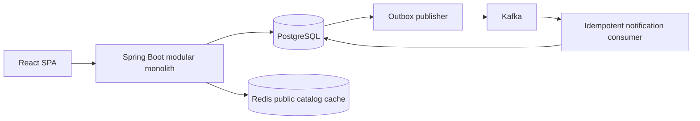
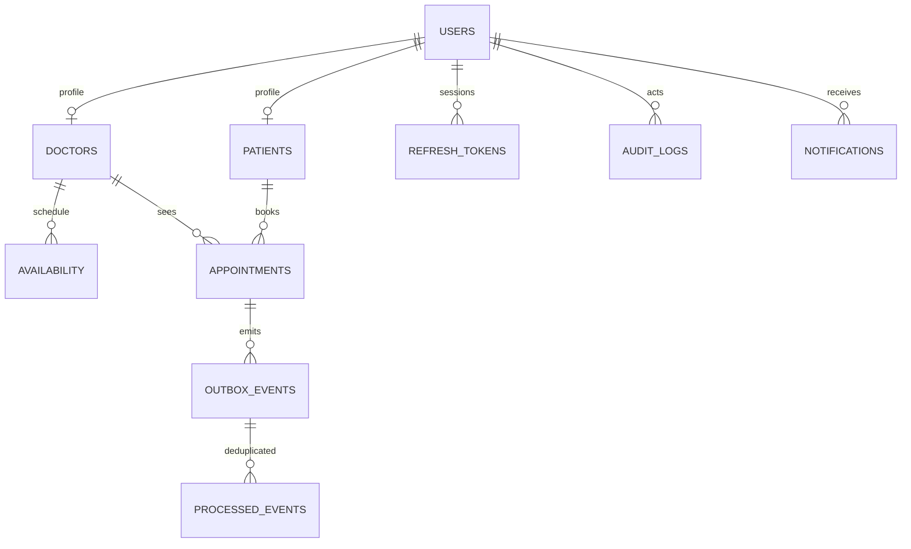

# Architecture

## CareBridge 2.0 extension (target, not a completion claim)

The master request extends the existing appointment platform with care coordination, recovery, configured gap detection and a FHIR R4 mapping boundary. Retain the current modular monolith and API contracts. New persistence uses additive migrations; never modify applied V1. Care plans own goals and typed activities (investigation, follow-up, referral); referral execution has a separate explicit lifecycle and an optional verified appointment link. Plan/referral versions, row locks and immutable history prevent silent lost updates. Provider authorization is scoped per responsible/receiving assignment, not by role alone. Patients have read access only to their own care records. Clinical free text stays out of event payloads and audit metadata. See IMPLEMENTATION_PLAN.md for ordered gates and actual implementation progress.

CareBridge is a Java 25 / Spring Boot 3.5.16 modular monolith and React 19 TypeScript SPA. Controllers validate DTOs; services enforce ownership and transaction boundaries; Spring Data JPA repositories persist to PostgreSQL 17.6. Flyway owns schema changes and Hibernate validates them. UUID references have database foreign keys where appropriate; entities intentionally do not expose ORM graphs as API responses.

The SPA uses React Router, TanStack Query, React Hook Form/Zod and Tailwind. Axios defaults to `/api/v1`, configurable through `VITE_API_BASE_URL`. Vite development proxy target is `API_PROXY_TARGET`; production nginx proxies to the backend service. The recommended deployment uses one public HTTPS origin to retain Strict HttpOnly refresh cookies.

Passwords are BCrypt hashes. Access JWTs expire after 15 minutes and live only in browser memory. Random refresh tokens are SHA-256 hashed at rest, rotated under a database lock, and expire after seven days. Replays revoke their family; logout revokes refresh tokens, while an already-issued access JWT can remain valid until expiry. Role and enabled status come from the database on authenticated requests. Auth cookie endpoints enforce an exact Origin allowlist.

Redis caches public catalog DTOs only. Live slots and booking validation read PostgreSQL. Doctor row locks serialize booking and schedule changes; the partial GiST exclusion constraint independently rejects active overlapping appointments. Times are UTC instants interpreted against recurring local schedules in the doctor's IANA zone. Ambiguous DST intervals are rejected. Booking, audit and outbox writes share one transaction.

Kafka is retained because the implementation already relies on it. Outbox publishers acknowledge broker writes before marking published; retries may deliver duplicates. Consumer transactions deduplicate by event ID and write persisted inbox notifications plus a follow-up event. Failures retry then reach a dead-letter topic. Notifications are an in-app inbox, not SMS/email delivery. No additional microservices are introduced.

Local topology is five Compose services. Production topology is two application containers behind a host TLS proxy plus private managed PostgreSQL/Redis/Kafka. The backend runs continuously for scheduling and consumption. See DEPLOYMENT.md for tradeoffs and operating requirements. Optional recovery/MFA/clinical-record workflows are outside the established implementation scope. Cross-tab refresh coordination, retention jobs and batched DTO reads remain improvements.




Outbox aggregate IDs and processed event IDs are logical references: consumer data must survive independently of producer retention.

```mermaid
sequenceDiagram
  participant P as Patient
  participant S as Appointment service
  participant D as PostgreSQL
  P->>S: Book interval
  S->>D: BEGIN; lock doctor row
  S->>D: Validate account, weekly schedule and overlap
  S->>D: Insert appointment (exclusion constraint)
  S->>D: Insert audit + outbox
  S->>D: COMMIT
  S-->>P: 201 or 409
```

```mermaid
sequenceDiagram
  participant O as Outbox publisher
  participant D as PostgreSQL
  participant K as Kafka
  participant N as Notification consumer
  O->>D: Lock due batch SKIP LOCKED
  O->>K: Send event ID keyed by appointment
  K-->>O: Broker acknowledgement
  O->>D: Mark published and commit
  K->>N: At-least-once delivery
  N->>D: INSERT processed event ON CONFLICT DO NOTHING
  N->>D: Insert inbox notifications + notification outbox; commit
  N-->>K: Acknowledge after commit
```
