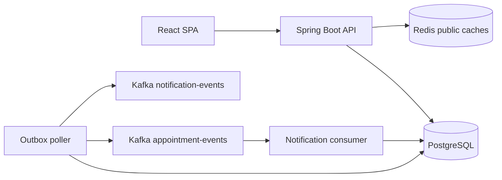
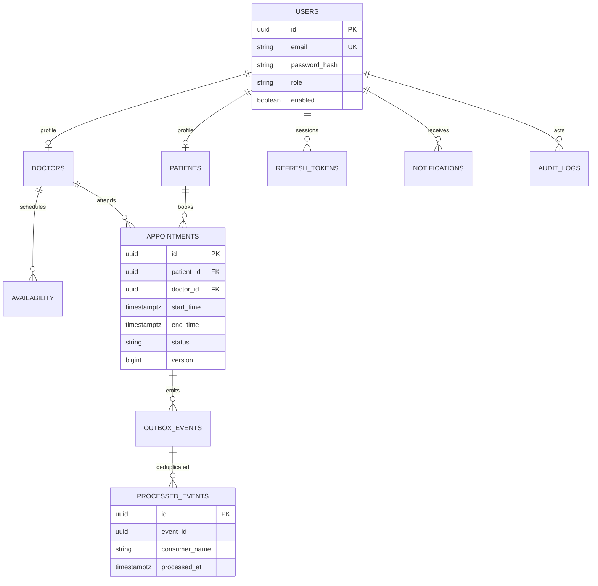
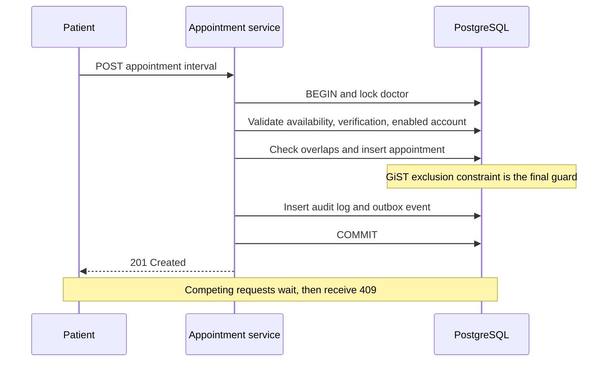

# CareBridge 2.0

The original appointment platform now includes closed-loop care plans and referrals, Kafka-driven appointment recovery, explicitly configured care-gap rules, and validated FHIR R4 exports. Existing authentication, profiles, scheduling and admin workflows are preserved. Java **21** is the agreed application, Docker and CI target.

Providers create plans from confirmed/completed visits, record goals and outcomes, and track referral completion. Patients see their own care journey and can join waiting lists for expiring appointment offers. Rule-based alerts resolve on completion and reopen when a cancelled referral visit needs scheduling again. No clinical recommendations are inferred.

See [TESTING.md](TESTING.md), [FHIR_INTEGRATION.md](FHIR_INTEGRATION.md), [EVENT_ARCHITECTURE.md](EVENT_ARCHITECTURE.md), and [SECURITY.md](SECURITY.md) for evidence and boundaries. Cloud configurations are prepared; no cloud deployment or compliance certification is claimed.

Current audit and launch gates: [PROJECT_STATUS.md](PROJECT_STATUS.md) and [LAUNCH_CHECKLIST.md](LAUNCH_CHECKLIST.md). See [LOCAL_SETUP.md](LOCAL_SETUP.md) for exact PowerShell/Linux/macOS startup commands, [ARCHITECTURE.md](ARCHITECTURE.md), [API_DOCUMENTATION.md](API_DOCUMENTATION.md), and [DEPLOYMENT.md](DEPLOYMENT.md). Production configuration is prepared; Docker runtime, hosted CI and external production acceptance remain unverified.

Healthcare appointment and care coordination platform: Java 21 / Spring Boot, React / TypeScript, PostgreSQL, Kafka and Redis. A modular monolith with real authentication, transactional scheduling, asynchronous database inbox notifications, and role-specific workspaces.

## Start locally

Install Docker Engine/Desktop with Compose v2. Copy `.env.example` to `.env` and replace every `CHANGE_ME` value. Generate a JWT secret with `openssl rand -base64 48` (or an equivalent cryptographically secure generator). Choose separate strong database, administrator and demo passwords.

```sh
docker compose up --build --wait
```

Open **http://localhost:3000**. API: **http://localhost:8080/api/v1**. Swagger UI: **http://localhost:8080/swagger-ui/index.html**. Health: **http://localhost:8080/actuator/health**.

The administrator is provisioned once from `ADMIN_EMAIL` and `ADMIN_PASSWORD`. There is no public administrator registration endpoint. Existing users are never promoted by provisioning. Remove provisioning variables after creating the administrator in a deployed environment.

The development Compose stack uses loopback-only host ports, single-node Kafka KRaft, persistent PostgreSQL and Kafka volumes, health checks and non-root application images. `SECURE_COOKIES=false` is needed for local HTTP; HTTPS deployments must use `true`. Stop with `docker compose down`; adding `-v` deletes local database and Kafka volumes.

## Demo data

With Node 22.19+ and the backend running:

```sh
node scripts/seed-demo.mjs
```

The script loads the root `.env`, requires `DEMO_PASSWORD`, authenticates as your provisioned administrator, and calls real APIs. It creates three fictional doctors, verifies their profiles, adds weekly clinic hours, creates a patient and books/confirms one future appointment. Repeated runs reuse the accounts and avoid duplicate availability. Use only with a local development database.

| Account | Email | Password |
| --- | --- | --- |
| Patient | `patient@carebridge.example` | Your `DEMO_PASSWORD` |
| Cardiologist | `ananya@carebridge.example` | Your `DEMO_PASSWORD` |
| General medicine | `arjun@carebridge.example` | Your `DEMO_PASSWORD` |
| Dermatologist | `maya@carebridge.example` | Your `DEMO_PASSWORD` |
| Administrator | Your `ADMIN_EMAIL` | Your `ADMIN_PASSWORD` |

No credentials are committed. A generated, ignored `.env` may be present in the original development workspace; use its values for that local installation. Notification delivery is a database inbox only. No email, SMS, video visits or payment processing is claimed. Consultation fees are displayed in INR and paid outside this application.

## Features

- Patient and doctor registration, BCrypt password hashes, signed access JWTs, rotating hashed refresh tokens, family revocation and logout.
- Patient profile editing; public verified doctor discovery with name/specialty filters, pagination and fee/experience sorting.
- Doctor profiles, weekly availability, clinic timezones, live 90-day slot discovery and protected patient details tied to an appointment.
- Booking, confirmation, rejection, cancellation, rescheduling and completion with explicit state transitions and ownership checks.
- PostgreSQL overlap protection, service-level locking, optimistic versioning, atomic audit and outbox writes.
- Kafka outbox delivery with retries and failed-event recovery; transactional notification deduplication and consumer dead-letter recovery.
- Redis public profile, specialty and weekly schedule caches with TTLs and post-commit invalidation.
- Admin doctor verification, account controls, filtered appointment search, analytics, audit history and outbox retry.
- Responsive React workspaces with validated forms, loading/error/empty/success states, notifications and refresh-token session restoration.

## Architecture and folder layout

```text
backend/
  pom.xml, Dockerfile
  src/main/java/com/carebridge/
    CareBridgeApplication.java
    config/          security, CORS, Redis, Kafka, health, request IDs, OpenAPI
    common/          errors, validated pagination
    auth/            registration, login, tokens, current account
    user/            shared account and roles
    patient/         patient profiles
    doctor/          public catalog, doctor profiles
    availability/    weekly windows, timezone rules, live slots
    appointment/     transactional booking and transitions
    audit/           durable operation log
    outbox/          event schema, polling, publishing
    notification/    Kafka listener, deduplication, inbox
    admin/           verification, account controls, analytics, recovery
  src/main/resources/db/migration/V1__schema.sql
  src/test/java/com/carebridge/
frontend/
  src/pages/         landing/auth, doctors, appointments, profile, admin, dashboard
  src/components/    shared form/status components, patient details
  src/api.ts         Axios bearer/refresh coordination
  src/auth.tsx       in-memory identity, protected routes
  e2e/               browser tests against the real API
scripts/seed-demo.mjs
docs/architecture.md
PROJECT_STATUS.md
.github/workflows/ci.yml
```

Feature packages keep related DTOs, controllers, services, entities and repositories together without unnecessary package nesting. Controllers perform request mapping and validation; services own transactions, authorization and business rules. JPA entities are never returned from controllers. Services use constructor injection; the appointment service also receives its JPA persistence context for explicit lock-and-refresh behavior.





The migration defines all columns, lengths, checks, indexes and physical foreign keys. Outbox aggregate and processed-event relationships in the diagram are logical references: consumers must not depend on producer retention. `(event_id, consumer_name)` and `(user_id, event_id)` are unique. Hibernate uses `ddl-auto=validate`; Flyway alone changes the schema. `btree_gist` requires extension installation permission during migration; a restricted production runtime account can be separate from the migration account.

## Concurrency and transaction boundaries

Every booking locks its doctor row using `PESSIMISTIC_WRITE`. Schedule edits, doctor verification and rescheduling use the same lock. The service validates the authoritative PostgreSQL schedule and looks for active overlaps after acquiring the lock. Redis and browser results are advisory only.

PostgreSQL independently enforces this partial GiST exclusion constraint:

```sql
EXCLUDE USING gist (
  doctor_id WITH =,
  tstzrange(start_time, end_time, '[)') WITH &&
) WHERE (status IN ('PENDING', 'CONFIRMED'))
```

Half-open intervals permit adjacent appointments. Different start times do not bypass overlap detection. Cancelled, rejected and completed rows do not reserve future capacity. Appointment `@Version` provides additional lost-update protection. For modifications, the service locks the doctor and refreshes/locks the appointment before testing state; it does not trust an entity read before waiting for the lock.



Rescheduling changes the same appointment atomically and resets it to PENDING for a fresh doctor confirmation. A conflicting target slot rolls back the entire operation and retains the original reservation. Schedule edits that would invalidate future active appointments roll back. Timezone changes are disallowed while active appointments remain.

`PlatformIT.exactlyOneConcurrentHttpBookingCommits` launches eight concurrent authenticated HTTP requests with distinct patients. It asserts one 201, seven 409s, one appointment, one audit row and one outbox row. A separate direct SQL test proves the database rejects overlaps with different start times. Tests use a PostgreSQL Testcontainer by default; an explicit external PostgreSQL test URL is supported for hosts without Docker. No H2 or mocked database is used for these tests.

## Time and appointment states

Appointment timestamps are ISO-8601 instants stored as PostgreSQL `timestamptz`; application persistence uses UTC. Weekly hours are local wall-clock times with ISO day numbers (Monday=1), interpreted using the doctor's IANA timezone. The UI labels the clinic timezone for date selection and displays appointment times in the viewer's timezone. Booking is limited to the next 90 days and exact, full-duration slots aligned with a weekly window. Overnight windows are not supported. Nonexistent or ambiguous DST slots and offset-crossing intervals are rejected/skipped.

Allowed transitions:

| From | To | Actor |
| --- | --- | --- |
| PENDING | CONFIRMED or REJECTED | Owning doctor |
| PENDING / CONFIRMED | CANCELLED | Owning patient or doctor, before start |
| CONFIRMED | COMPLETED | Owning doctor, after end |
| PENDING / CONFIRMED | PENDING at a new time | Owning patient, before start |

Terminal appointments cannot be modified. Patients cannot confirm appointments. Administrators can inspect appointments but do not override their clinical state through admin APIs.

## Authentication and authorization

1. Registration creates one common account and its role-specific profile in a transaction. Doctor accounts start unverified. Role fields are not accepted in public requests.
2. Login validates BCrypt and returns a 15-minute HS256 JWT with issuer `carebridge`, subject UUID and role. The signing key must be base64-encoded random bytes, at least 32 bytes after decoding.
3. A random 48-byte refresh token is stored only as a SHA-256 hash. Its cookie is HttpOnly, SameSite=Strict, scoped to `/api/v1/auth`, and Secure by default. Refresh validity is seven days from each rotation.
4. Refresh locks the old token, revokes it and issues a new token in the same family. Reusing a revoked/expired token revokes its family. Revocations deliberately commit even when the response is 401. Logout revokes the family.
5. The SPA keeps access tokens in memory, never localStorage. A shared in-flight refresh promise prevents simultaneous refreshes within a tab. On reload it restores the session via the cookie. Axios retries an authenticated request once after refreshing.
6. Bearer validation checks signature, expiry and issuer. Every authenticated request reloads the account to enforce current role and enabled status. Account disabling also revokes refresh tokens.
7. Role checks protect patient, doctor and admin routes; service checks enforce ownership. Doctors see only minimal patient contact/demographic details through their own appointments. No passwords or tokens appear in user/admin DTOs or audit metadata.

All `/auth` POST endpoints require an exact allowed `Origin` header, including command-line clients. This is the CSRF defense for cookie-authenticated operations; normal application mutations require a bearer token. CORS allows only configured origins, methods and headers. Deploy the SPA/API on the same site for Strict cookies. Never log request bodies or authorization headers at a production proxy. An inherited `DEBUG` environment variable can enable Spring debug logging: unset it or explicitly set `DEBUG=false`.

## Kafka delivery, retry and recovery

Appointments write an outbox row in their own database transaction. The scheduled publisher locks up to 20 due rows using `FOR UPDATE SKIP LOCKED`, sends each to Kafka keyed by appointment UUID, waits for broker acknowledgement, and only then marks the row PUBLISHED. A crash between Kafka acknowledgement and database commit can duplicate a message; this is intentionally at-least-once delivery.

```mermaid
sequenceDiagram
    participant DB as PostgreSQL outbox
    participant P as Poller
    participant K as Kafka
    participant N as Notification service
    P->>DB: Lock due batch
    P->>K: Publish event
    K-->>P: Broker acknowledgement
    P->>DB: Mark PUBLISHED, commit
    K->>N: Deliver appointment event
    N->>DB: INSERT processed event ON CONFLICT DO NOTHING
    alt first delivery
      N->>DB: Persist patient + doctor inbox notifications
      N->>DB: Add notification-events outbox row, commit
    else duplicate
      N->>DB: No side effects
    end
    N-->>K: Listener returns; offset acknowledged
```

Schema version 1 for `appointment-events`:

```json
{
  "schemaVersion": 1,
  "eventId": "UUID",
  "appointmentId": "UUID",
  "patientId": "UUID",
  "doctorId": "UUID",
  "eventType": "APPOINTMENT_BOOKED",
  "timestamp": "2026-11-05T10:00:00Z"
}
```

Other types: `APPOINTMENT_CONFIRMED`, `APPOINTMENT_CANCELLED`, `APPOINTMENT_RESCHEDULED`, `APPOINTMENT_REJECTED`, `APPOINTMENT_COMPLETED`. Payloads contain no names, credentials or appointment reasons. `notification-events` uses the same envelope with `NOTIFICATION_PERSISTED` and a new event ID.

- Publisher failures use exponential backoff (2 seconds initially, capped at one hour). After 12 failures, rows become FAILED. They remain durable and visible in the admin event queue; retry through `POST /admin/outbox/{id}/retry` after resolving the broker problem. No event is silently discarded.
- Consumer processing inserts its deduplication key, notifications and notification outbox in one PostgreSQL transaction. A failure rolls them all back. Record acknowledgement happens only after the transactional service returns.
- Listener failures retry three times with a one-second backoff, then publish to `appointment-events.DLT`. The recoverer waits for successful DLT publication; failed recovery must not acknowledge the source record. Malformed/unsupported events are also routed through error handling.
- DLT replay is an operator action after inspecting/fixing the cause. Preserve the original event ID when replaying the original payload; deduplication makes replay safe. Kafka tooling can consume the DLT and republish corrected payloads; the UI does not edit or replay DLT records.
- Concurrent publishers and retries can change event arrival order. Inbox events are history, not an ordered state projection; clients read current appointment state from PostgreSQL.

## Redis

Public doctor profiles use a two-minute TTL; specialty lists five minutes; weekly availability thirty seconds. Profile, availability, verification and account updates invalidate all catalog caches after successful database commit. Broad invalidation is simple and safe for this initial catalog size. Redis failures are logged and public queries fall back to PostgreSQL; health remains DOWN so operators can detect the failure. Concurrent cache fills or unavailable Redis may leave an advisory entry until its TTL. Live slot queries and all booking validation always read PostgreSQL.

The cache stores only public DTOs, using Spring's JDK value serialization. Redis must remain on a trusted private network: do not expose the unauthenticated development instance publicly. No private profile or auth response is cached. `RedisIT` verifies real Redis miss/hit behavior and post-commit invalidation.

## API reference

All paths below are relative to `/api/v1`. JSON inputs reject unknown fields. Successful creates return 201, deletes/logout return 204, other successful operations return 200. Paged responses have `content`, `totalElements`, `totalPages`, `number`, `size`. `page` is zero-based; `size` is capped at 100; `sort=field,asc|desc` is allowlisted per resource.

| Method | Path | Access / purpose |
| --- | --- | --- |
| POST | `/auth/register/patient`, `/auth/register/doctor` | Register; allowed Origin required |
| POST | `/auth/login`, `/auth/refresh`, `/auth/logout` | Login/session rotation/revocation; allowed Origin required |
| GET, PUT | `/patients/me` | Own patient profile |
| GET | `/doctors` | Public; `q`, `specialization`, page/sort |
| GET | `/doctors/specializations` | Public catalog |
| GET | `/doctors/{id}` | Public verified profile |
| GET | `/doctors/{id}/availability` | Public weekly windows |
| GET | `/doctors/{id}/slots?date=YYYY-MM-DD` | Live slots, date in clinic timezone |
| GET, PUT | `/doctors/me` | Own doctor profile |
| GET, POST | `/doctors/me/availability` | Own weekly availability |
| PUT, DELETE | `/doctors/me/availability/{id}` | Own window |
| POST | `/appointments` | Patient; `doctorId`, `startTime`, `endTime`, optional `reason` |
| GET | `/appointments/me`, `/doctors/me/appointments` | Own appointments; `status`, `from`, `to`, pagination/sort |
| GET | `/appointments/{id}` | Owning patient/doctor or admin |
| GET | `/appointments/{id}/patient` | Owning doctor only; minimal patient details |
| PATCH | `/appointments/{id}/cancel` | Owning patient/doctor |
| PATCH | `/appointments/{id}/reschedule` | Owning patient; new `startTime`, `endTime` |
| PATCH | `/appointments/{id}/confirm`, `/reject`, `/complete` | Owning doctor |
| GET | `/notifications` | Own persisted inbox |
| GET | `/admin/users`, `/admin/patients`, `/admin/doctors` | Admin; users optionally filtered by `role` |
| PATCH | `/admin/doctors/{id}/verify` | Admin; `{ "verified": true }` |
| PATCH | `/admin/users/{id}/enabled` | Admin; `{ "enabled": false }`; admin accounts excluded |
| GET | `/admin/appointments` | Admin; `status`, `doctorId`, `patientId`, `from`, `to` |
| GET | `/admin/analytics`, `/admin/audit-logs`, `/admin/outbox` | Admin dashboards/operations |
| POST | `/admin/outbox/{id}/retry` | Admin; failed events only |

For appointment range filters, `from` is inclusive and `to` exclusive. Public doctor sorts: `specialization`, `experienceYears`, `consultationFee`, `createdAt`; appointment sorts: `startTime`, `createdAt`, `status`. OpenAPI exposes validated DTO schemas and all endpoint operations.

```json
{
  "timestamp": "2026-11-05T10:00:00Z",
  "status": 409,
  "error": "Conflict",
  "message": "The selected appointment slot is no longer available",
  "path": "/api/v1/appointments"
}
```

Validation errors use 400, missing/expired authentication 401, ownership/role failures 403, missing records 404, invalid state/concurrent conflicts 409. Responses do not expose stack traces or SQL exception messages. A server-generated `X-Request-ID` appears in structured logs for correlation.

## Versions and configuration

| Component | Pinned version |
| --- | --- |
| Java | 21; locally verified with Temurin 21.0.13 |
| Maven | 3.9.11 in Docker |
| Spring Boot BOM | 3.5.16 (Spring Web, Security/Jose, JPA/Hibernate, Validation, Actuator, Kafka, Redis, Cache, Flyway, PostgreSQL JDBC, JUnit, Mockito) |
| springdoc | 2.8.17 |
| Testcontainers | 1.21.4 |
| PostgreSQL / Redis / Kafka | 17.6 / 7.4.5 / 3.9.1 |
| Node | 22.19.0 in CI and Docker |
| React / TypeScript / Vite / Tailwind | 19.1.1 / 5.9.2 / 7.3.7 / 3.4.17 |
| Axios / Router / TanStack Query | 1.21.0 / 7.18.5 / 5.90.2 |
| React Hook Form / Zod / resolvers | 7.63.0 / 4.6.7 / 7.0.3 |
| Playwright | 1.64.1 |

All frontend dependencies are exact in `package.json` and transitively locked in `package-lock.json`. The minimatch override under TypeScript ESLint selects 11.0.4 to address a reported glob amplification advisory; lint was rerun with the override. Backend transitive versions are pinned by the Boot/Testcontainers BOMs. Spring Boot 3.5.16 supports Java 21 ([Spring requirements](https://docs.spring.io/spring-boot/3.5/system-requirements.html)); springdoc 2.x is for Boot 3 ([springdoc compatibility](https://springdoc.org/v2/)). Update and retest dependencies before an Internet-facing deployment; pinning is reproducibility, not a permanent security guarantee.

| Environment variable | Default / purpose |
| --- | --- |
| `DATABASE_URL` | `jdbc:postgresql://localhost:5432/carebridge` (Compose sets internal host) |
| `DATABASE_USER`, `DATABASE_PASSWORD` | `carebridge`; password required |
| `JWT_SECRET` | Required base64 random signing key |
| `ADMIN_EMAIL`, `ADMIN_PASSWORD` | Optional one-time account provisioning |
| `ALLOWED_ORIGINS` | `http://localhost:3000,http://localhost:5173`, exact comma-separated origins |
| `SECURE_COOKIES` | `true`; local HTTP requires `false` |
| `REDIS_HOST`, `REDIS_PORT` | `localhost`, `6379` |
| `KAFKA_BOOTSTRAP_SERVERS` | `localhost:9092` |
| `JOBS_ENABLED` | `true`; controls outbox scheduler |
| `DEMO_PASSWORD` | Seed script only, no default |
| `API_URL` | Seed script API base override |

Native development after starting infrastructure with `docker compose up -d postgres redis kafka`:

```sh
# Export .env values in your shell; Spring does not automatically load .env.
mvn -f backend/pom.xml spring-boot:run
cd frontend
npm ci
npm run dev
```

Use `http://localhost:5173` in the browser so Origin matches the configuration. Vite proxies `/api` to port 8080. The Nginx production image proxies the same prefix to `backend:8080` and supplies CSP and other response headers.

## Tests and CI

```sh
# Full backend suite; Docker must be running for default Testcontainers paths.
mvn -B -f backend/pom.xml verify

# Unit tests only.
mvn -B -f backend/pom.xml test

cd frontend
npm ci
npm run lint
npm run build
npm audit
# Start and seed the application first. Credentials are read from ../.env.
npx playwright install chromium
npm run test:e2e
```

For external test services, set `PG_TEST_URL`, `PG_TEST_USER`, `PG_TEST_PASSWORD`, `REDIS_TEST_HOST`, and `REDIS_TEST_PORT`. **Use a disposable test database: PlatformIT truncates its tables.** Default tests require Docker and fail visibly when unavailable; they are not silently skipped. Kafka integration uses a real embedded Kafka broker. `E2E_BASE_URL` overrides the browser base URL; `CHROME_PATH` can select an installed Chrome binary.

CI runs backend unit/integration tests, frontend lint/build/audit, and a Compose health smoke test on pushes and pull requests. No paid deployment is configured. Test reports are uploaded even on failure. See `PROJECT_STATUS.md` for executed test results and verification limits; a workflow file is not evidence that hosted GitHub Actions has run.

## Observability and operational boundaries

Actuator checks database, Redis and Kafka connectivity. Only health/info are exposed, and public health omits details. JSON log output includes request correlation IDs. Audits cover registration, failed login, doctor verification, account controls, appointment changes and manual outbox retry. Audit metadata does not contain medical reasons, passwords, cookies or tokens.

This is an engineering reference application, not a certified clinical system. Before production deployment, provide TLS, private authenticated Redis/Kafka, secret rotation, backups with restore testing, monitoring and alerts, rate limiting, account verification/recovery, infrastructure vulnerability scanning, retention policies and appropriate organizational/privacy review. Those are not silently claimed as implemented.

Known limitations and future work:

- No email verification, password-reset flow, MFA, payments, SMS/email provider or clinical records.
- One recurring weekly calendar per doctor; no holidays, date-specific exceptions, overnight windows or multi-clinic schedules.
- Session family replay protection can sign out a second browser tab refreshing an already-rotated token; cross-tab refresh coordination is a future improvement.
- Outbox, processed-event, audit and revoked-refresh retention/archival require an operational policy; rows are retained in this version.
- Batch publishing holds database locks while waiting for broker acknowledgements, trading simplicity for throughput. Worker leases and per-aggregate ordering are possible later improvements.
- Catalog invalidation is broad and advisory. Redis keys are not a booking authority.
- Admin analytics are basic counts and UTC date groupings. Large datasets will benefit from projections and query optimization; some DTO mapping currently performs per-row lookups.
- Docker image builds and full Compose execution require a functioning Docker host; local native test results do not establish Compose success.
