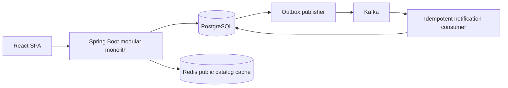
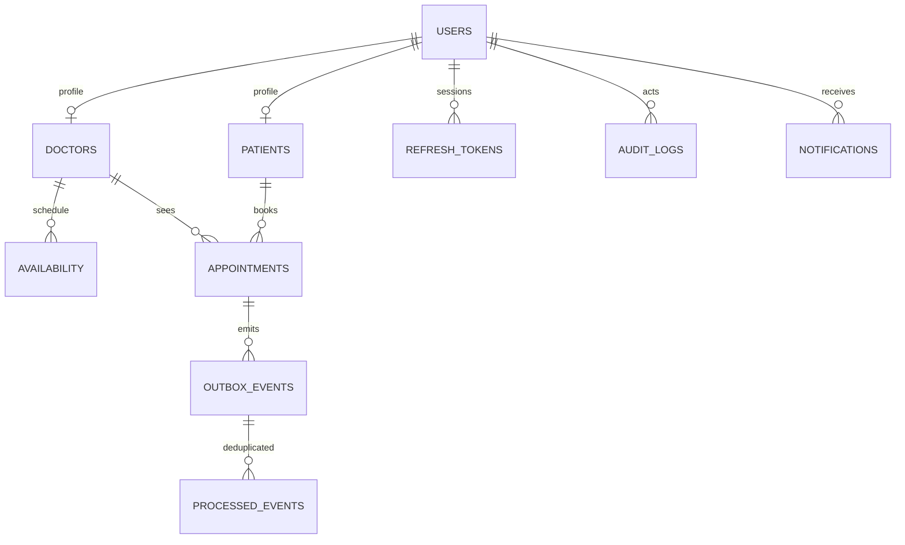

# Architecture




Outbox aggregate IDs and processed event IDs are logical references: consumer data must survive independently of producer retention.

```mermaid
sequenceDiagram
  participant P as Patient
  participant S as Appointment service
  participant D as PostgreSQL
  P->>S: Book interval
  S->>D: BEGIN; lock doctor row
  S->>D: Validate account, weekly schedule and overlap
  S->>D: Insert appointment (exclusion constraint)
  S->>D: Insert audit + outbox
  S->>D: COMMIT
  S-->>P: 201 or 409
```

```mermaid
sequenceDiagram
  participant O as Outbox publisher
  participant D as PostgreSQL
  participant K as Kafka
  participant N as Notification consumer
  O->>D: Lock due batch SKIP LOCKED
  O->>K: Send event ID keyed by appointment
  K-->>O: Broker acknowledgement
  O->>D: Mark published and commit
  K->>N: At-least-once delivery
  N->>D: INSERT processed event ON CONFLICT DO NOTHING
  N->>D: Insert inbox notifications + notification outbox; commit
  N-->>K: Acknowledge after commit
```
